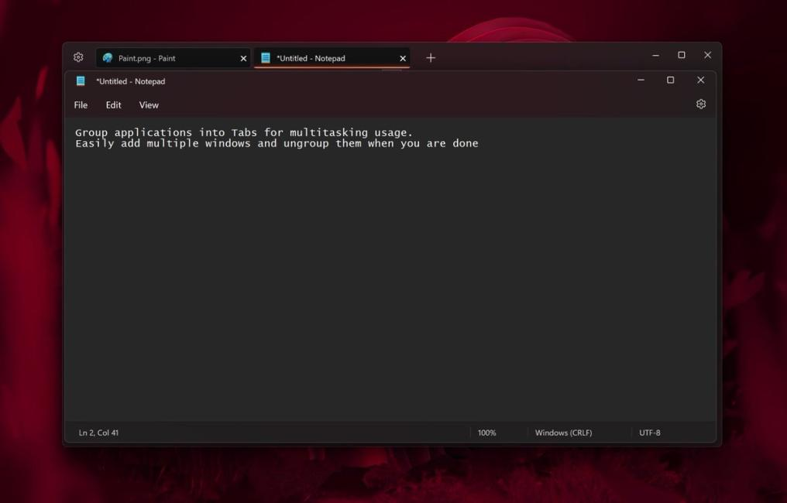

#  United Sets X

*Group any windows into tabs — hold Shift and drag a window onto another one, like Groupy*

United Sets X is a fork of [United Sets](https://github.com/Windows-Apps-Hub/UnitedSets) by Get, FireCubeStudios
and contributors (MIT license, see [LICENSE](LICENSE)). It fixes many bugs of the original and adds Groupy-like
features: grouping by dragging, several sets, a tray-only background mode, taskbar thumbnails per tab...

The Microsoft Store versions of [United Sets](https://www.microsoft.com/store/apps/9N7CWZ3L5RWL) are the original app,
not this fork.

## Screenshot



## Features

- Group any window into tabs of a *set* window. Several set windows can be open at the same time
  (open United Sets again, or use **+ › New Set Window**).
- Runs in the notification area: starting it only shows a tray icon (left click: new set, right click: new set /
  settings / exit). Closing a set never quits United Sets, only *Exit* in the tray menu does.
  Optional *Start with Windows* setting.
- **Hold <kbd>Shift</kbd> (or Ctrl / Alt / Tab, see the settings) and drag a window onto another window** (e.g. two Chrome profiles): both become tabs of
  a new set that takes the place of that window, like Groupy. Drop it onto a set to add it as a tab, or into an
  empty cell of a splitable tab. A highlight shows where the window will go. (Grouping without holding a key, by
  dropping on the title bar / tab bar, can be enabled in the settings.)
- Drag a tab to another set's tab bar to move it (the window keeps its settings), or drop it outside
  to release the window (or open it in a new set, see the settings).
- <kbd>Win</kbd> + <kbd>`</kbd> / <kbd>Win</kbd> + <kbd>Shift</kbd> + <kbd>`</kbd>: next / previous tab of the active set.
- Minimizing or maximizing a tabbed window minimizes or maximizes its set.
- Taskbar like Groupy: hovering a set's taskbar button shows a thumbnail for each tab (click to switch, close button
  closes the tab), and the button uses the icon of the selected app.
- Compact, browser-like tab bar and native Windows 11 controls following the Windows accent color (Mica Alt);
  tabbed windows use the full width of the set.
- Tabbed windows follow the set without lagging behind when it is moved, including between monitors with different scaling.
- Tabs show a dot when their window asks for attention (flashes).
- If United Sets crashes or is killed, windows that were hidden in background tabs are shown again on the next start.
- Errors are logged to `%AppData%\UnitedSets\error.log`.

## Building

Requirements:

- .NET 10 SDK
- Windows SDK 10.0.26100 (Visual Studio Installer component, or `winget install Microsoft.WindowsSDK.10.0.26100`)

```
dotnet build UnitedSets/UnitedSets.csproj -c DebugUnpackaged -p:Platform=x64
```

The `DebugUnpackaged` configuration runs without installing an MSIX package
(`UnitedSets/bin/x64/DebugUnpackaged/net10.0-windows10.0.26100.0/UnitedSets.exe`).
It needs the Windows App SDK 1.8 runtime.

## Warning

The program is still in the beta state. Therefore, bugs and minor inconveniences are to be expected.
If we find a bug, we will put them in the [Issues](https://github.com/FireCubeStudios/UnitedSets/issues) Tab.
However, we might be unable to list all of them and/or we don't know about the bug.
Therefore, feel free to create the issue if you find a bug.

Be cautious when using in the work environment. Save your work very often on the apps used with Untied Sets. We do not want you to lose your work. 🙏🙏🙏

## NuGet Packages owned by us and referenced by us

We believe that using nuget packages that are owned by us without sharing the source code may seem like it is not fully transparent.
We have compile the list [here](nuget_list_by_contributor.md) with the source code associated to it, so anybody can fully review the source code there as well.
